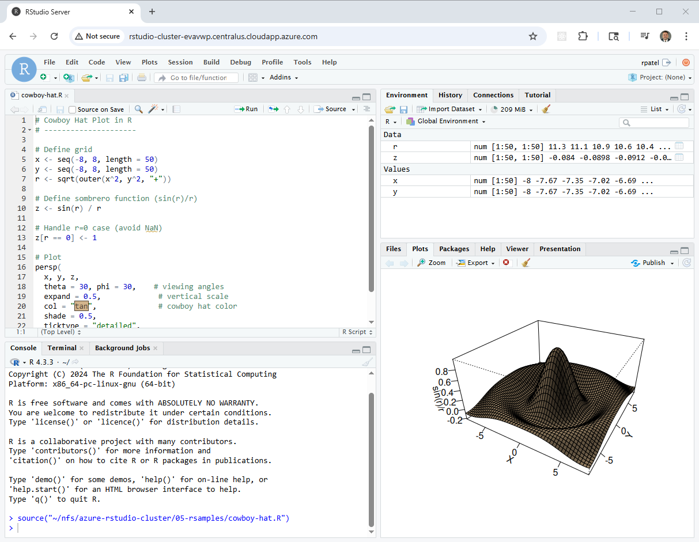
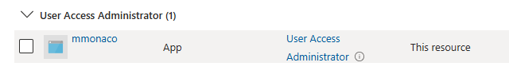

# RStudio Server on Azure AKS: Kubernetes, Azure Files NFS and Active Directory

An **RStudio Server** cluster that runs as pods on **Azure Kubernetes
Service**, built on the [Azure Mini Active Directory](https://github.com/mamonaco1973/azure-mini-ad)
lab and the VM-based
[azure-rstudio-cluster](https://github.com/mamonaco1973/azure-rstudio-cluster).
An **NGINX ingress controller** on a static public IP spreads users across
RStudio pods; each pod gets the AD join password from **Key Vault** through
workload identity, joins a **mini-AD** domain when it starts, and mounts a
Premium **Azure Files NFS** share for home directories and a shared R
package library. A Windows VM and a Samba gateway, reached through **Azure
Bastion**, give admins access to the same files.



| Piece | Where | Role |
|---|---|---|
| **aks-vnet** | `10.0.0.0/8` | `vm-subnet` (`10.240.0.0/24`, VMs and AKS nodes), `mini-ad-subnet` (`10.240.1.0/24`), `AzureBastionSubnet` (`10.240.2.0/24`); NAT gateway for outbound traffic |
| **rstudio-aks** | `rstudio-aks-rg` | AKS on Azure CNI with a Standard load balancer; OIDC issuer and workload identity on; default pool `Standard_D2s_v3`, 1 to 4 nodes with the cluster autoscaler |
| **NGINX ingress** | Helm, `ingress-nginx` | on a static public IP with DNS label `k8s<suffix>`; HTTP 80; cookie session affinity (`rstudio_session`); load balancer probe on `/auth-sign-in` |
| **rstudio** | StatefulSet | 2 replicas (HPA 2 to 4); requests 0.5 CPU and 500 MiB, limits 2 CPU and 3000 MiB; service account `keyvault-access-sa` |
| **k8s-identity** | user-assigned identity | federated to `keyvault-access-sa`; Key Vault Secrets User, Network Contributor; the cluster pulls from ACR with AcrPull |
| **rstudio&lt;suffix&gt;** | ACR, Basic | the RStudio image |
| **nfs&lt;suffix&gt;** | Storage, Premium FileStorage | NFS share `nfs` (100 GiB), reached through a private endpoint and the `privatelink.file.core.windows.net` zone; the pods mount it at `/nfs` and `/home` through a persistent volume |
| **nfs-gateway-&lt;suffix&gt;** | `rstudio-servers-rg` | Ubuntu 24.04, `Standard_B1s`; joined to AD; mounts the share and serves `/nfs` over Samba |
| **win-ad-&lt;suffix&gt;** | `rstudio-servers-rg` | Windows Server, `Standard_DS1_v2`; joined to AD; RSAT; maps the gateway's share as `Z:` |
| **mini-AD** | `mini-ad-subnet` | [`module-azure-mini-ad`](https://github.com/mamonaco1973/module-azure-mini-ad) Samba DC for `rstudio.mikecloud.com` (`RSTUDIO`) |
| **ad-key-vault-&lt;suffix&gt;** | Key Vault | admin, user, VM and RStudio passwords |
| **bastion-host** | `AzureBastionSubnet` | Azure Bastion; the VMs have no public IPs |

## Architecture

<picture>
  <source media="(prefers-color-scheme: dark)" srcset="architecture-dark.svg">
  
</picture>

Regenerate with `python3 make_diagram.py`. The gateway and Windows VM also
join the domain; those lines are left off the diagram to keep it readable.

- **`01-directory/`**: the resource groups, VNet, subnets, NAT gateway,
  network security group, Bastion, Key Vault and its secrets, ACR, and the
  mini-AD DC with users and groups from `scripts/users.json.template`.
- **`02-servers/`**: the NFS storage account, share and private endpoint,
  the gateway and Windows VMs.
- **`03-docker/rstudio/`**: the RStudio image (`Dockerfile`, install scripts
  and `startup.sh`).
- **`04-aks/`**: the cluster, the identity and its federated credential,
  the NGINX Helm release and IP, and `yaml/rstudio-app.yaml.tmpl` (storage
  class, volume and claim, secret, StatefulSet, services, ingress and HPA).
- **`05-rsamples/`**: sample R scripts and `packages.R`.
- **`06-utils/`**: `getNextUID` / `getNextGID` scripts for adding AD users.

## How a pod starts

The image's `startup.sh` starts D-Bus, signs in to Azure as the pod's
workload identity, reads the AD admin password from Key Vault, joins the
domain with `realm join` (SSSD with short names and the POSIX IDs from AD),
gives `linux-admins` passwordless sudo, writes `Rprofile.site` so the
library path is the user's own library, then `/nfs/rlibs`, then the system
library, and runs RStudio Server in the foreground. `/nfs/rlibs` belongs to
`rstudio-admins`.

Because `/home` lives on the share, a user sees the same files whichever pod
the ingress sends them to.

## Users and groups

| User | uidNumber | Groups | Notes |
|---|---|---|---|
| jsmith | 10001 | rstudio-users, us, linux-admins, rstudio-admins, Domain Admins | sudo; writes `/nfs/rlibs` |
| edavis | 10002 | rstudio-users, us | |
| rpatel | 10003 | rstudio-users, india, linux-admins, rstudio-admins, Domain Admins | sudo; writes `/nfs/rlibs` |
| akumar | 10004 | rstudio-users, india | |

| Group | gidNumber |
|---|---|
| rstudio-users | 10001 (every user's primary group) |
| us | 10002 |
| india | 10003 |
| linux-admins | 10004 |
| rstudio-admins | 10005 |

## Prerequisites

* [An Azure Account](https://portal.azure.com/)
* [Install AZ CLI](https://learn.microsoft.com/en-us/cli/azure/install-azure-cli)
* [Install Terraform](https://developer.hashicorp.com/terraform/install)
* [Install Docker](https://docs.docker.com/engine/install/)
* [Install kubectl](https://kubernetes.io/docs/tasks/tools/) and
  [jq](https://jqlang.github.io/jq/download/)

`check_env.sh` expects a service principal in `ARM_CLIENT_ID`,
`ARM_CLIENT_SECRET`, `ARM_SUBSCRIPTION_ID` and `ARM_TENANT_ID`. It needs the
**User Access Administrator** role as well as Contributor, because
Terraform creates role assignments:



If this is your first time following along, we recommend starting with this
video: [Azure + Terraform: Easy Setup](https://www.youtube.com/watch?v=j4aRjgH5H8Q).

## Deploy

```bash
git clone https://github.com/mamonaco1973/azure-rstudio-aks.git
cd azure-rstudio-aks
./apply.sh
```

`apply.sh` applies `01-directory` and `02-servers`, builds the RStudio image
and pushes it to ACR if the tag isn't there yet, applies `04-aks`, then
renders and applies `rstudio-app.yaml`. It ends by running `validate.sh`,
which waits for the ingress's DNS name to return HTTP 200:

```
NOTE: Waiting for endpoint: http://k8s<suffix>.centralus.cloudapp.azure.com
NOTE: RStudio ready at: http://k8s<suffix>.centralus.cloudapp.azure.com
```

## Try it

1. Open the URL and sign in as one of the users above, with the password
   from its `*-ad-credentials` secret in Key Vault.
2. Add a user:
   1. Connect to `win-ad-<suffix>` through **Bastion** as `jsmith` or
      `rpatel` and open **Active Directory Users and Computers** with
      **View > Advanced Features** on.
   2. Under the domain's **Users** container, create the user with a UPN
      such as `mcloud@rstudio.mikecloud.com` and an initial password.

      

   3. Run `getNextUID.bat` from `06-utils` for the next free `uidNumber`.
   4. In **Attribute Editor**, set `uidNumber` to that value, `gidNumber` to
      `10001`, and `uid` to the login name.
   5. Under **Member Of**, add `rstudio-users` and any other groups.
   6. Connect to `nfs-gateway-<suffix>` through Bastion and check the
      mapping with `id mcloud`:

      

   7. Sign in to RStudio as the new user. They can't write `/nfs/rlibs`
      until they're in `rstudio-admins`.

## Teardown

```bash
./destroy.sh
```

## Notes

- **Lab only.** RStudio is served over plain HTTP. The VM network security
  group allows 22, 3389, 445, 8787, 2049 and 80 from anywhere, though the
  VMs have no public IPs.
- Every pod joins the domain when it starts, so replaced pods leave
  computer accounts behind in AD.
- The gateway clones **azure-rstudio-cluster** into the share, not this
  repository, so the samples and `06-utils` under `Z:` come from that
  project.
- `yaml-diagram.png`, the old Kubernetes components picture, was removed
  with the other old diagrams.
- The old README listed `india` as 10002 and `us` as 10003; the template
  sets `us` to 10002 and `india` to 10003.
